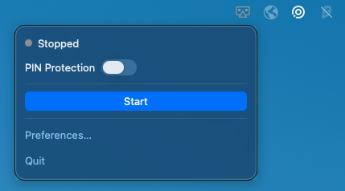
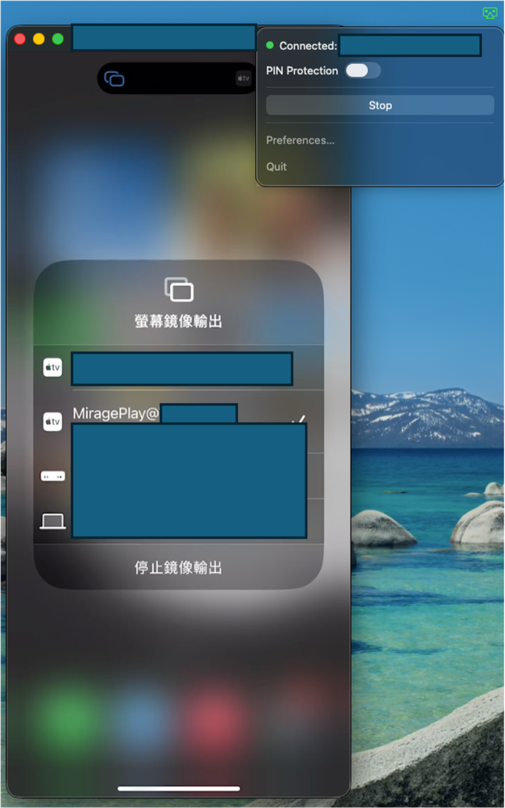

# MiragePlay

接收 iPhone／iPad AirPlay 鏡像的 macOS 選單列 App。

[English](../README.md) | 繁體中文

## 這是什麼

MiragePlay 把 Mac 變成 AirPlay 鏡像接收端 —— 在 iPhone／iPad 上選這台 Mac，裝置畫面就會出現在 Mac 上。
它常駐 menu bar（選單列）：沒有 Dock 圖示、沒有主視窗；直接在本機網路上接收，沒有帳號、不經雲端轉送、
不上傳任何內容。接收核心是嵌進 App 的 UxPlay，App 本身是它的 UI、生命週期與打包層。



尚未開始投影：面板顯示 Stopped。



開始投影後：面板顯示已連線的裝置名稱。

## 系統需求

| 項目 | 需求 |
|---|---|
| macOS | 15.0 以上（`app/Package.swift`：`platforms: [.macOS("15.0")]`） |
| CPU | Apple silicon（arm64）。不支援 Intel Mac。 |

從原始碼建置所需的工具鏈列在[從原始碼建置](#從原始碼建置)一節。

## 安裝

release 壓縮檔就是發布版本身：下載的 `.zip` 裡面是已簽章的 `MiragePlay.app`，
加上本說明、`docs/` 底下的文件、授權全文與第三方聲明。什麼都不必自行建置。

1. 下載對應版本的 release 壓縮檔（`.zip`）並解壓 —— 會得到一個名為 `mirageplay-<version>` 的資料夾，裡面是 `MiragePlay.app`、本說明、`docs/`、`LICENSE`、`THIRD-PARTY-NOTICES.md` 與 `CONTRIBUTING.md`。
2. 把 `MiragePlay.app`（應用程式包，bundle）拖進 `/Applications`。
3. 首次啟動。這個 bundle 是 ad-hoc signing（臨時簽章）、未經 notarization，
   所以 Gatekeeper 會攔下第一次啟動：對 App 按右鍵 → **打開** → **打開**，
   或到「系統設定」→「隱私權與安全性」→ **仍要打開**。

    *進階選項*：若 Gatekeeper 仍然擋下啟動，可改用 Terminal 清除隔離屬性 ——
    `xattr -cr /Applications/MiragePlay.app` —— 再開一次 App。
4. 選單列圖示出現 —— 見[使用方式](#使用方式)。

想自己建置？見[從原始碼建置](#從原始碼建置)。

## 使用方式

1. 點選單列圖示 —— 面板打開，內有 **Start** / **Stop**。
2. 按 **Start**。接收端等待連線時圖示轉為橘色。
3. 在 iPhone／iPad：控制中心 → 螢幕鏡像輸出 → 選這台 Mac。
4. 鏡像進行中圖示為綠色；面板顯示裝置名稱。
5. **Stop** 結束這次連線。**Quit** 結束 App。

各狀態的選單列顏色意義見 [狀態顏色](usage.md#status-colours)。

## 從原始碼建置

建置工具鏈：

- Xcode Command Line Tools（`xcode-select --install`）：`swift`、`clang`、`codesign`、`iconutil`
- `git` —— 用於版本標記與 UxPlay checkout
- Homebrew —— 僅作為 C 相依套件的來源；`brew` 必須在 `PATH` 上

```bash
brew install cmake openssl@3 libplist gstreamer librsvg
./scripts/build/build-core.sh --embedded
./scripts/build/build-app.sh
```

`scripts/setup/deps.sh` 會安裝 `cmake`、`openssl@3`、`libplist`、`gstreamer` 與 `librsvg`（提供 `rsvg-convert`）。

這些依賴也可以用其他來源安裝。

release 建置、冒煙測試與建置注意事項見 [build.md](build.md)。

## 原始碼

本專案的原始碼在 <https://github.com/miles0428/MiragePlay> —— 與 App 內 About 視窗連到的位址相同。
clone 下來後照 [build.md](build.md) 建置；issue 與 pull request 也送那裡。

MiragePlay 以 GPL-3.0-only 授權（見 [LICENSE](../LICENSE)）。App 內嵌的第三方元件及其版本、授權，
列在 [THIRD-PARTY-NOTICES.md](../THIRD-PARTY-NOTICES.md)。

## 授權

GPL-3.0-only，見 [LICENSE](../LICENSE)。

receiver core 不屬於本 repo 的原始碼；它是 UxPlay 的 fork，於建置時以 vendored 方式取得。
`core/vendor.lock` 記錄了確切的上游：

| 欄位 | 值 |
|---|---|
| Repository | `https://github.com/miles0428/UxPlay.git` |
| Branch | `mirageplay` |
| Commit | `4f5ad4bdeb345448871e2ab39f9793f35f499664` |

`scripts/build/vendor-uxplay.sh` 會取得該 pinned commit（由 `build-core.sh` 自動觸發），
驗證 commit、tree、檔案數量與逐檔 SHA-256 manifest，任何不符即 fail closed。
`core/vendor.lock` 指名的 commit 即為 MiragePlay release 所附 core 的對應源碼。

## 安全性

安全性問題請勿開公開 issue，請私下通知維護者。金鑰資料不進入版控。

## 致謝

- UxPlay
- GStreamer

## 參與貢獻

參見 [CONTRIBUTING.md](../CONTRIBUTING.md)。

### 文件

- [從原始碼建置](build.md)
- [使用方式](usage.md)
- [語言](language.md)
- [設定與資料位置](configuration.md)